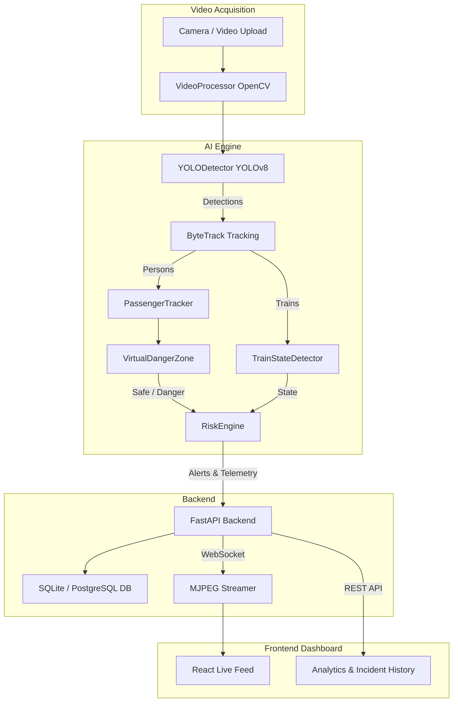

# RailGuard AI Architecture

## Flow of Data
1. A video frame is captured.
2. `YOLODetector` infers bounding boxes and `ByteTrack` links frame-to-frame IDs.
3. `TrainStateDetector` evaluates train movement (Approaching/Stopped/Departing).
4. `PassengerTracker` computes the feet point and delegates to `VirtualDangerZone` to determine safe vs. danger side.
5. If in danger zone, `PassengerTracker` measures time spent.
6. `RiskEngine` triggers critical alert if time >= 3s and train is moving.
7. Backend broadcasts JSON telemetry and base64 encoded frame via WebSocket.
8. Frontend renders overlay UI elements and displays incidents dynamically.
